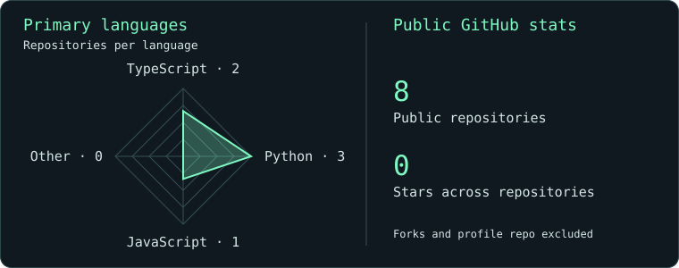

# Vatsal Bhardwaj

<p align="center"></p>

```text
vatsal@github:~$ whoami
AI projects · web applications · Python backends
```

Hi, I'm Vatsal. I build AI tools, web apps, and Python backends. My projects cover technology news, public services, and urban traffic.

[Repositories](https://github.com/vatsalbhardwaj007?tab=repositories) · [GitHub activity](https://github.com/vatsalbhardwaj007#js-contribution-activity)

## `~/` toolbox

`TypeScript` · `JavaScript` · `Python` · `FastAPI` · `PostgreSQL` · `Supabase` · `HTML` · `CSS`

## `~/` selected work

| Project | What it does | Stack |
| --- | --- | --- |
| [Oculus AI](https://github.com/vatsalbhardwaj007/Oculus-AI) · [Live site](https://oculus-ai-sand.vercel.app/) | Tracks developments in technology and surfaces the updates worth reading. | TypeScript |
| [EduCompass AI](https://github.com/vatsalbhardwaj007/EduCompass-AI) · [Live demo](https://edu-compass-ai.vercel.app/) | An AI education web app. | TypeScript |
| [YojanaSetu](https://github.com/vatsalbhardwaj007/Yojana-Setu-BACKEND) | Powers government scheme discovery and eligibility checks, with a WhatsApp integration. | Python, FastAPI, Supabase |
| [Urban Grid](https://github.com/vatsalbhardwaj007/Urban-Grid) | Forecasts congestion and visualizes traffic in a 3D model of the city. | Python |

## `~/` languages and stats



## `~/` contribution calendar


[View my contribution history](https://github.com/vatsalbhardwaj007#js-contribution-activity)
